

  

<a href="https://ko-fi.com/dakotakronberger"><strong>Support Dakota on Ko-fi ☕</strong></a>

---

  <a href="#contents">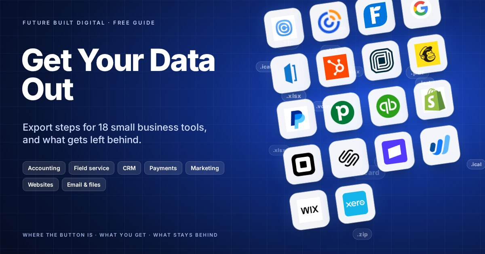</a>

<h1 align="center">How to Export Your Data From 18 Small Business Tools</h1>
<h3 align="center">(Before You Switch, Cancel, or Get Locked Out)</h3>

<strong>Where the export button lives, what you actually get, and what gets left behind, for the accounting, field service, CRM, payment, marketing and website tools small businesses run on.</strong>

By <strong>Dakota Kronberger</strong> · <a href="https://www.futurebuiltdigital.com">Future Built Digital</a> · Checked November 2026

  <a href="#contents"><strong>Find your tool ↓</strong></a> &nbsp; · &nbsp;
  <a href="https://github.com/kodyk448/small-business-data-export-guide/raw/refs/heads/main/downloads/export-checklist.csv"><strong>Download the export checklist ↓</strong></a> &nbsp; · &nbsp;
  <a href="https://www.futurebuiltdigital.com/start-a-project"><strong>Get help moving your data ↗</strong></a>

Free to read, copy and share. No sign-up.

<table>
  <tr>
    <td align="center" width="33%"><strong>18 TOOLS</strong> Accounting to websites</td>
    <td align="center" width="33%"><strong>THE EXACT CLICKS</strong> Checked against each vendor’s help pages</td>
    <td align="center" width="33%"><strong>WHAT’S LEFT BEHIND</strong> So nothing surprises you after you cancel</td>
  </tr>
</table>

---

## Find the tool you’re leaving

| Business job | Tools in this guide |
| :--- | :--- |
| 💵 **[Accounting and Bookkeeping](#accounting)** | [QuickBooks Online](#quickbooks) · [Xero](#xero) · [FreshBooks](#freshbooks) · [Wave](#wave) |
| 🛠️ **[Field Service and Jobs](#field-service)** | [Jobber](#jobber) · [Housecall Pro](#housecall-pro) |
| 🤝 **[Customers and Sales](#crm)** | [HubSpot](#hubspot) · [Pipedrive](#pipedrive) |
| 💳 **[Payments](#payments)** | [Square](#square) · [Stripe](#stripe) · [PayPal](#paypal) |
| 📣 **[Marketing and Bookings](#marketing)** | [Mailchimp](#mailchimp) · [Constant Contact](#constant-contact) · [Calendly](#calendly) |
| 🌐 **[Websites and Online Stores](#website)** | [Shopify](#shopify) · [Squarespace](#squarespace) · [Wix](#wix) |
| 📁 **[Email and Files](#workspace)** | [Google Workspace and Takeout](#google-workspace) |

**Also in this guide:** [What “export” really means](#what-export-means) · [Three export plans](#export-plans) · [When an export isn’t enough](#when-export-isnt-enough) · [Export one thing this week](#export-one-thing)

---

You don’t think about exporting your data until you need it. The card on file declined and the account went read-only. The new software wants a CSV by Friday. The bookkeeper who set everything up left. Or the price went up again and you’re finally switching.

That’s the worst time to learn that your customer list comes out fine but the job history doesn’t, that the download link expired last Tuesday, or that your website can’t leave at all.

Every tool you pay for is holding a piece of your business: customers, jobs, invoices, emails, payment history. Most of them will hand it over. Some hand over less than you’d think. A couple barely hand over anything.

We went through 18 tools small businesses actually use and wrote down three things for each one: where the export button lives, what you get, and what stays behind. The steps come from each vendor’s own help pages, checked in November 2026. Where a vendor’s page wouldn’t load for us, the entry says so.

Pick the tool you’re worried about. Run its export this week, while nothing’s on fire.

## What “export” really means

“Export” covers at least four different things, and the button doesn’t tell you which one you’re getting.

| What you get | What to expect |
| :--- | :--- |
| **A full export** | One button, most of your data. QuickBooks Online’s Export data tool and Wave’s Data Export are close to this. Even these skip things. |
| **A list export** | One list at a time: customers here, invoices there. Most CRMs and field-service apps work this way, so a complete backup is five or six exports. |
| **A report export** | You export a report, not the data. You get the columns the report shows, for the dates you picked. |
| **No export** | The thing can’t leave. Wix sites, saved card numbers (which only ever go processor to processor) and most design and automation settings. |

A few things almost never come with you, whatever the tool: **attachments and photos**, **activity history** (calls, notes, email opens), **saved cards**, and **settings** like automations, templates and availability rules. Screenshot the settings. Ask about the rest before you cancel.

### Who can press the button

Exports are usually admin-only. Housecall Pro limits customer and job exports to Admins, Pipedrive’s full export is for global admins, Wix contacts can only be exported by the site owner, and Square only takes card-export requests from the account owner. If the person who set the tool up has left, sort out access first.

### Download it the same day

Export files expire. Constant Contact keeps yours for 7 days, Google Takeout about 7 days (and 5 downloads), Pipedrive 28 days, HubSpot and Mailchimp 30. Put the download on the same to-do as the export.

### Open the file

An export you haven’t opened is a guess. Check the row count against what the tool says you have, scroll to the last row, and look for the columns you care about. Jobber, for example, splits big client lists into files of about 1,500 rows, so one file might not be all of them.

---

## 💵 Accounting and Bookkeeping

The books your accountant and the tax office will ask for, long after you stop paying for the software.

###  01 · QuickBooks Online

**[Export your books to Excel ↗](https://quickbooks.intuit.com/learn-support/en-us/help-article/list-management/export-reports-lists-data-quickbooks-online/L1xleDrLp_US_en_US)**

**Best for:** Anyone switching accountants, software, or closing the business

<a href="https://quickbooks.intuit.com/learn-support/en-us/help-article/list-management/export-reports-lists-data-quickbooks-online/L1xleDrLp_US_en_US">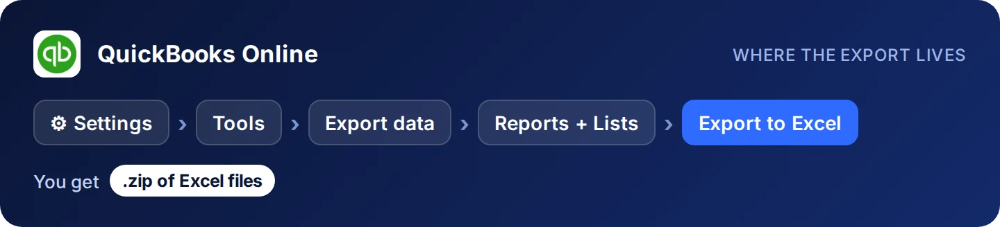</a>

QuickBooks has a real export-everything button, which puts it ahead of most tools on this list. The Export data tool bundles the reports and lists you switch on into one zip of Excel files. What it skips is anything that doesn't post to your books: estimates, purchase orders, customer statements and attachments each need their own export. Run the main export, then work through the leftovers below. Do it before you cancel; you get a year of read-only access on a paid plan, but only 90 days after a trial.

| Export details | What to know |
| :--- | :--- |
| **Where it lives** | ⚙ Settings → Tools → Export data → Reports + Lists → Export to Excel |
| **What you get** | Reports and lists of posting transactions, one Excel file each, bundled in a .zip. |
| **How it arrives** | Downloads when the export finishes. |
| **Left behind** | • Estimates and purchase orders (export from Sales or Expense transactions) • Customer statements (print to PDF per customer) • Attachments (Settings → Lists → Attachments → Batch actions → Export) • Recurring templates, chart of accounts, products and services (export each from its report) |
| **After you cancel** | Read-only for one year on a paid subscription. Trial accounts: export within 90 days. |
| **Who can do it** | Anyone whose role can open Settings → Export data. |

> **Do this today:** Run Export data for all dates, then export the Account List and Attachments so your accountant has the chart of accounts and the receipts.

[Official export steps ↗](https://quickbooks.intuit.com/learn-support/en-us/help-article/list-management/export-reports-lists-data-quickbooks-online/L1xleDrLp_US_en_US) · [What happens after you cancel ↗](https://quickbooks.intuit.com/learn-support/en-us/help-article/access-permissions/happens-quickbooks-online-data-cancel/L6qDpbE1B_US_en_US) · [↑ Browse the guide](#contents)

###  02 · Xero

**[Export Xero one section at a time ↗](https://central.xero.com/s/)**

**Best for:** Businesses and bookkeepers moving off Xero

<a href="https://central.xero.com/s/">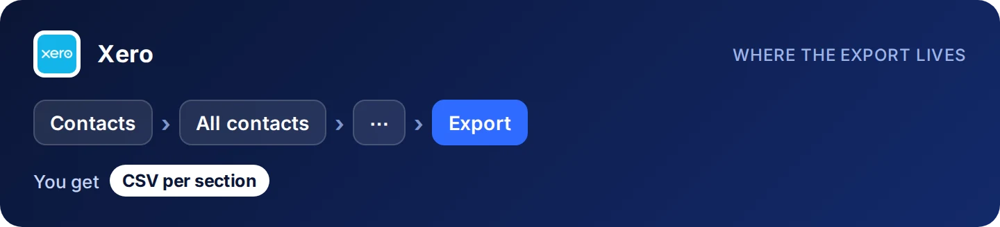</a>

Xero has no single download-my-data button. You export each section on its own: contacts, invoices, bills, the chart of accounts and the reports your accountant uses. Every export is a CSV, which is fine for moving to new software and less fine as a permanent record, so save PDFs of your key reports too. Contact groups don't come out in the contacts CSV, a gap Xero users have been asking about on Xero's own ideas forum for years.

| Export details | What to know |
| :--- | :--- |
| **Where it lives** | Contacts → All contacts → ⋯ → Export |
| **What you get** | • Contacts (CSV) • Invoices and bills (export from each list) • Chart of accounts (Accounting → Chart of accounts → Export) • Reports (export each one) |
| **How it arrives** | Each export downloads as a CSV file. |
| **Left behind** | • Contact group membership isn't a column in the contacts CSV • Anything you only keep as an attachment (check the files you need) |
| **After you cancel** | Your organisation is archived. Getting back in to export later can mean paying for a subscription again, so export first. |
| **Who can do it** | What you can export depends on your user role in the organisation. |

> **How we checked:** Xero Central wouldn't load for us, so these menu paths come from accountants' migration guides and Xero's ideas forum. Check them against Xero Central.

> **Do this today:** Export All contacts, the chart of accounts and a Profit and Loss and Balance Sheet for every year you've been on Xero.

[Official export steps ↗](https://central.xero.com/s/) · [Xero ideas forum: contact groups in exports ↗](https://productideas.xero.com/forums/967130-contacts-files/suggestions/46025308-contacts-export-contact-group) · [↑ Browse the guide](#contents)

###  03 · FreshBooks

**[Download clients, invoices and reports ↗](https://support.freshbooks.com/hc/en-us/articles/360032628152)**

**Best for:** Freelancers and service businesses billing out of FreshBooks

<a href="https://support.freshbooks.com/hc/en-us/articles/360032628152">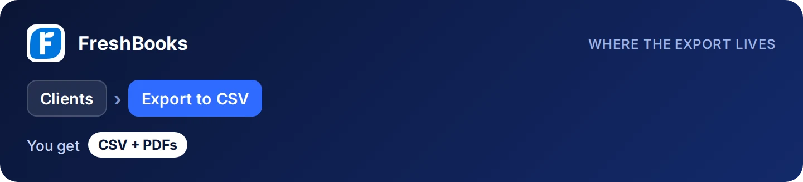</a>

FreshBooks lets you pull almost everything as CSV: clients (including archived ones and secondary contacts), invoices, expenses, items, vendors, the chart of accounts and reports. Invoices also download as PDFs through Bulk Actions, which is the version you want for your records. Estimates and proposals are the odd ones out: PDFs one at a time, or ask FreshBooks Support for a CSV.

| Export details | What to know |
| :--- | :--- |
| **Where it lives** | Clients → Export to CSV |
| **What you get** | • Clients, invoices, expenses, items, vendors, chart of accounts (CSV) • Invoices as separate PDFs (Bulk Actions) • Reports (CSV or PDF) • Expense receipt images |
| **How it arrives** | Downloads from each section. |
| **Left behind** | • Estimates and proposals: PDFs one by one, or a CSV by request from Support • Payroll is a separate set of reports and tax PDFs |
| **After you cancel** | FreshBooks' export article doesn't say. Export before you close the account. |
| **Who can do it** | Users who can open each section you export. |

> **Do this today:** Bulk-download every invoice as PDF and export the clients CSV. Those two cover most of what you'll ever be asked for.

[Official export steps ↗](https://support.freshbooks.com/hc/en-us/articles/360032628152) · [↑ Browse the guide](#contents)

###  04 · Wave

**[Request a Wave data export ↗](https://support.waveapps.com/hc/en-us/articles/4411360860692)**

**Best for:** Sole proprietors and very small businesses on free accounting

<a href="https://support.waveapps.com/hc/en-us/articles/4411360860692">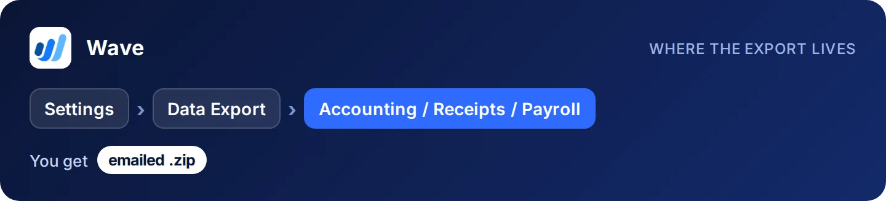</a>

Wave's Data Export sends a download link to the primary email on your account. The Accounting export is four files (every journal entry and transaction, bill items, customers, vendors) in CSV or Excel format. Receipts come as a zip of the original images. Two things trip people up: the export only covers the business you're currently viewing, and migration guides report that products, services and the chart of accounts aren't in it.

| Export details | What to know |
| :--- | :--- |
| **Where it lives** | Settings → Data Export → Accounting / Receipts / Payroll |
| **What you get** | • Accounting: transactions, bill items, customers, vendors (CSV or XLS) • Receipts: .zip of the original images • Payroll (Canadian businesses only) |
| **How it arrives** | A download link emailed to the account's primary email address. |
| **Left behind** | • Other businesses in the same login (export each one) • Products and services, and the chart of accounts, per migration guides |
| **After you cancel** | Wave's article doesn't say. Export while you can still log in. |
| **Who can do it** | Anyone who can open the business's settings. |

> **How we checked:** Wave's help center blocked our checker, so the menu path comes from Wave's community answers.

> **Do this today:** If you run two businesses in one Wave login, switch to each one and run the export separately.

[Official export steps ↗](https://support.waveapps.com/hc/en-us/articles/4411360860692) · [↑ Browse the guide](#contents)

---

## 🛠️ Field Service and Jobs

Customers, properties and job history from the app your crew runs the day on.

###  05 · Jobber

**[Export your client list ↗](https://help.getjobber.com/en/articles/export-client-information/)**

**Best for:** Home service crews switching field-service apps

<a href="https://help.getjobber.com/en/articles/export-client-information/">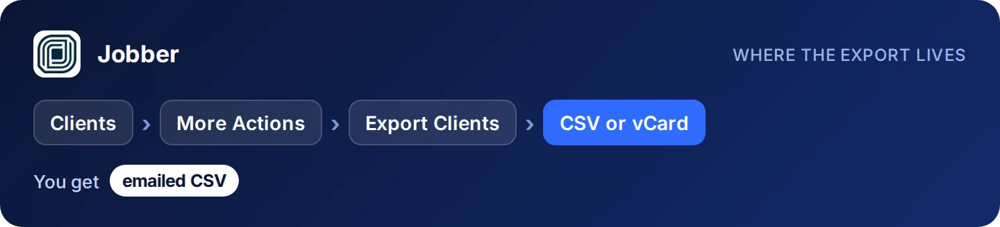</a>

Jobber's client export is solid: tags, property addresses, contact information and custom fields, as a CSV or vCard, emailed to you. Big lists arrive as several files, because one CSV holds about 1,500 rows. The client export is only the client list, though. Jobs, quotes and invoices live in Reports, and you export those one report at a time.

| Export details | What to know |
| :--- | :--- |
| **Where it lives** | Clients → More Actions → Export Clients → CSV or vCard |
| **What you get** | Clients with tags, property addresses, contact info and custom fields. |
| **How it arrives** | Emailed when it's ready. More than ~1,500 clients means several CSV files in one email. |
| **Left behind** | • Jobs, quotes, invoices and visit history (export from Reports) • Job photos and attachments |
| **Filter** | Export everyone, or only clients with a tag. Pick several tags and you only get clients with all of them. |
| **Who can do it** | Admin users. Team members with the Reports permission can export some client data. |

> **Do this today:** Export all clients as CSV, then open Reports and export the client and job reports your new software will ask for.

[Official export steps ↗](https://help.getjobber.com/en/articles/export-client-information/) · [↑ Browse the guide](#contents)

###  06 · Housecall Pro

**[Export customers and jobs ↗](https://help.housecallpro.com/en/articles/2847823-export-customer-list)**

**Best for:** Trade businesses moving customer and job history

<a href="https://help.housecallpro.com/en/articles/2847823-export-customer-list">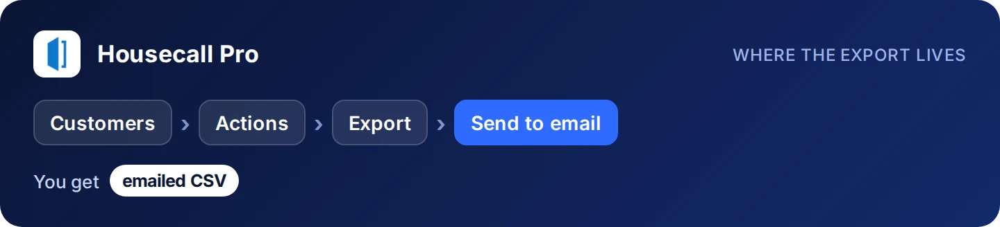</a>

Housecall Pro exports customers and jobs separately, and only Admins can do either. Both arrive by email from notifications@housecallpro.com, so check spam before you assume it failed. For job history with dates, set the jobs list's date range back to the day you started using Housecall Pro, or you'll only get recent work.

| Export details | What to know |
| :--- | :--- |
| **Where it lives** | Customers → Actions → Export → Send to email |
| **What you get** | • Customer list (CSV) • Jobs list (Jobs → Actions → Export) • Estimates from the dashboard's estimate list |
| **How it arrives** | Emailed from notifications@housecallpro.com. |
| **Left behind** | • Anything outside the date range you set • Anything that isn't a column in the file, like job photos (open it and check) |
| **Watch out** | Migration guides describe the dashboard jobs download as an .xlsx file and the Actions export as CSV. Check which one you got. |
| **Who can do it** | Admins only. |

> **Do this today:** Set the jobs date range from your first day on Housecall Pro to today before you export.

[Official export steps ↗](https://help.housecallpro.com/en/articles/2847823-export-customer-list) · [Import and export jobs and customers ↗](https://help.housecallpro.com/en/articles/6797101-how-to-import-export-jobs-and-customers) · [↑ Browse the guide](#contents)

---

## 🤝 Customers and Sales

The CRM where every lead, deal and note lives.

###  07 · HubSpot

**[Export every property, not just the view ↗](https://knowledge.hubspot.com/import-and-export/export-records)**

**Best for:** Anyone leaving HubSpot or backing up the CRM

<a href="https://knowledge.hubspot.com/import-and-export/export-records">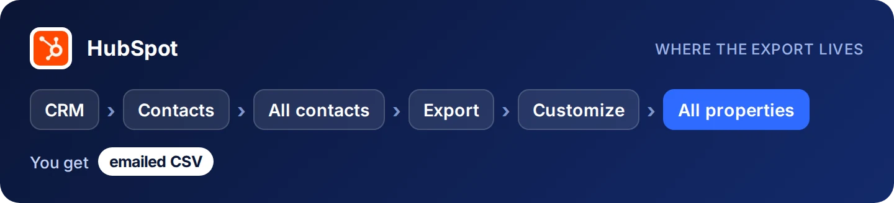</a>

The default HubSpot export only includes the columns in your current view, which is how people end up with a “backup” that's six columns wide. Click Customize in the export dialog and choose all properties (and associations, so you know which contact belongs to which company and deal). Pick CSV: it has no column limit, while XLS stops at 256 columns. Repeat for companies, deals and tickets.

| Export details | What to know |
| :--- | :--- |
| **Where it lives** | CRM → Contacts → All contacts → Export → Customize → All properties |
| **What you get** | Records with every property, plus associated record IDs if you choose associations. |
| **How it arrives** | A download link by email. Links expire after 30 days; CSVs over 2 MB come zipped. |
| **Left behind** | • Calls, notes, emails and other activity (export individual records, activity reports, or use the API) • Calls can be exported from CRM → Calls |
| **Limits** | • 300 exports per rolling 24 hours, three at a time • XLS: 256 columns. XLSX: 16,384. CSV: no column limit |
| **Who can do it** | Users with Export permission. |

> **Do this today:** Export All contacts with “All properties and associations on records” as CSV, then do the same for companies and deals.

[Official export steps ↗](https://knowledge.hubspot.com/import-and-export/export-records) · [↑ Browse the guide](#contents)

###  08 · Pipedrive

**[Run Pipedrive's global export ↗](https://support.pipedrive.com/en/article/exporting-data-from-pipedrive)**

**Best for:** Sales teams moving pipelines to a new CRM

<a href="https://support.pipedrive.com/en/article/exporting-data-from-pipedrive">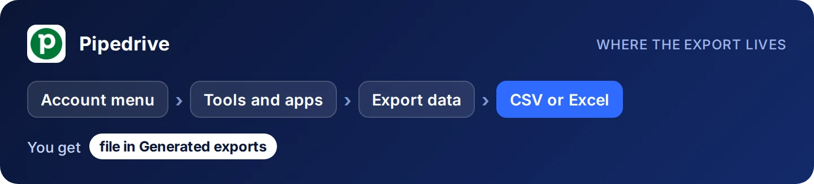</a>

Pipedrive's global export lets a global admin pull deals, people, organizations and other data types as CSV or Excel. The catch is the stuff attached to them: activities, notes and files linked to deals and contacts are exported separately, and files stored in Google Drive aren't exported at all. Finished files wait in Generated exports for 28 days.

| Export details | What to know |
| :--- | :--- |
| **Where it lives** | Account menu → Tools and apps → Export data → CSV or Excel |
| **What you get** | Deals, people, organizations and other data types, one export each. |
| **How it arrives** | In the Generated exports list, available for 28 days. |
| **Left behind** | • Activities, notes and files (separate exports) • Files stored in Google Drive |
| **No admin?** | Filter a list view, then ⋯ → Export filter results. Use the gear icon to choose columns. |
| **Who can do it** | Global admins for the full export. |

> **Do this today:** Export deals, people and organizations, then activities and notes, and check that the IDs line up across files.

[Official export steps ↗](https://support.pipedrive.com/en/article/exporting-data-from-pipedrive) · [↑ Browse the guide](#contents)

---

## 💳 Payments

Transaction history, customer lists and the one thing you can never download yourself: saved cards.

###  09 · Square

**[Export customers and sales ↗](https://squareup.com/help/gb/en/article/7871-export-card-on-file-to-third-party-payment-processors)**

**Best for:** Shops, salons and service businesses taking payments on Square

<a href="https://squareup.com/help/gb/en/article/7871-export-card-on-file-to-third-party-payment-processors">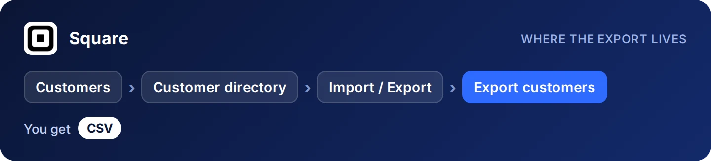</a>

Your Square customer directory exports to CSV in a few clicks: everyone, or specific groups. Sales come from the Transactions page, where Square sellers on the community forums use the Transactions CSV for payments and the Item Detail CSV for what was sold, matched on Transaction ID. Saved cards are different: you can't download them, but the account owner can ask Square to send them, encrypted, to your new processor.

| Export details | What to know |
| :--- | :--- |
| **Where it lives** | Customers → Customer directory → Import / Export → Export customers |
| **What you get** | • Customer directory (CSV) • Transactions and item details (CSV, from Transactions → Export) |
| **Cards on file** | The owner calls Square Support to verify, then Square sends an encrypted file to a PCI DSS Level 1 processor. Expect up to two weeks. |
| **Left behind** | • Card numbers never come to you directly • Some names captured from card swipes show on Transactions but not in the directory export (per Square's seller community) |
| **Watch out** | Export the customer directory too, so the new processor can match cards to customers. |
| **Who can do it** | Account owner for card exports. |

> **Do this today:** Export the full customer directory and a Transactions CSV for every year you've used Square.

[Official export steps ↗](https://squareup.com/help/gb/en/article/7871-export-card-on-file-to-third-party-payment-processors) · [↑ Browse the guide](#contents)

###  10 · Stripe

**[Export customers and payments ↗](https://support.stripe.com/questions/export-customer-data-without-the-payment-details)**

**Best for:** Online businesses and anyone billing subscriptions

<a href="https://support.stripe.com/questions/export-customer-data-without-the-payment-details">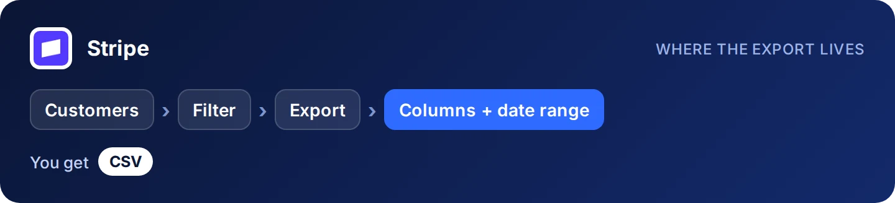</a>

Stripe's Customers and Payments pages both have an Export button where you pick the time zone, date range and columns. That gives you customer details without payment methods. To move saved cards, you request a payment data export: Stripe prepares an encrypted file and sends it only to a processor that's PCI DSS Level 1 compliant. For your books, Stripe points you at the Balance report rather than the payments list.

| Export details | What to know |
| :--- | :--- |
| **Where it lives** | Customers → Filter → Export → Columns + date range |
| **What you get** | • Customers (no payment methods) • Payments, filterable by successful, refunded, uncaptured or all • Balance summary and itemized reports for accounting |
| **Cards on file** | Request a payment data export. The encrypted file goes to the new processor, not to you. |
| **Left behind** | Card and bank details in the customer export. |
| **Watch out** | Fees in the payments export combine Stripe's fees with any platform fees. |
| **Who can do it** | Users with access to Customers and Payments in the Dashboard. |

> **Do this today:** Export customers and all payments for each year, then download the Balance summary for your accountant.

[Official export steps ↗](https://support.stripe.com/questions/export-customer-data-without-the-payment-details) · [Request a payment data export ↗](https://docs.stripe.com/get-started/data-migrations/pan-export) · [↑ Browse the guide](#contents)

###  11 · PayPal

**[Download your activity report ↗](https://www.paypal.com/us/cshelp/article/help145)**

**Best for:** Anyone who's been paid through PayPal

<a href="https://www.paypal.com/us/cshelp/article/help145">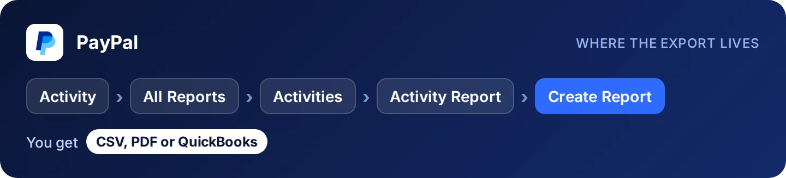</a>

PayPal keeps up to seven years of activity, but you request it 12 months at a time. Choose “Balance affecting” as the transaction type for the version that matches your balance, pick CSV for spreadsheets or the QuickBooks format for your bookkeeper, and repeat for each year. On older accounts this takes a while; it's worth doing once and saving the files.

| Export details | What to know |
| :--- | :--- |
| **Where it lives** | Activity → All Reports → Activities → Activity Report → Create Report |
| **What you get** | Transaction activity as CSV, PDF, QuickBooks, Quicken or TAB. |
| **How it arrives** | The report builds, then you click Download. |
| **Range** | Up to the past seven years, up to 12 months per report. |
| **Watch out** | Menu names differ between business and personal accounts and older views. |
| **Who can do it** | The account holder. |

> **Do this today:** Request one “Balance affecting” CSV per year back to when you opened the account.

[Official export steps ↗](https://www.paypal.com/us/cshelp/article/help145) · [↑ Browse the guide](#contents)

---

## 📣 Marketing and Bookings

Your email list and the people who booked time with you.

###  12 · Mailchimp

**[Export your audience ↗](https://mailchimp.com/help/view-export-contacts/)**

**Best for:** Anyone with an email list on Mailchimp

<a href="https://mailchimp.com/help/view-export-contacts/">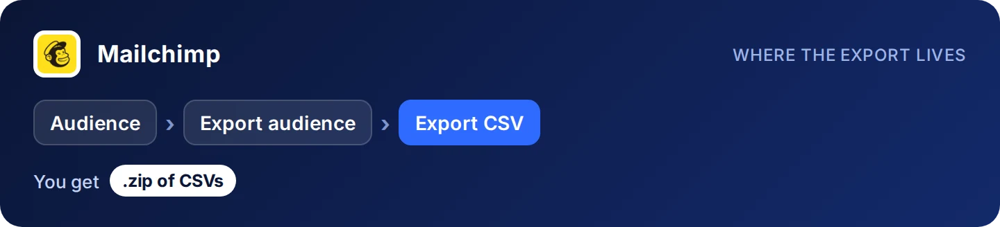</a>

Your Mailchimp export is a zip with one CSV per contact type: subscribed, unsubscribed, non-subscribed and cleaned. Keep the unsubscribed file even though you can't email those people; it's how your new tool knows not to. The export includes fields, tags, notes and opt-in times. It doesn't include opens, clicks or purchase history, and campaign results are a separate report download.

| Export details | What to know |
| :--- | :--- |
| **Where it lives** | Audience → Export audience → Export CSV |
| **What you get** | Audience fields, tags, notes, marketing permissions, member rating, opt-in time and IP. |
| **How it arrives** | A .zip of CSV files, kept in Export history for 30 days. |
| **Left behind** | • Opens, clicks and signup source • Purchase history • Campaign reports (download each report separately) |
| **Partial exports** | Export a segment, tag or group instead of the whole audience. |
| **Who can do it** | Users with access to the audience. |

> **Do this today:** Export each audience and keep all four CSVs, including the unsubscribed and cleaned ones.

[Official export steps ↗](https://mailchimp.com/help/view-export-contacts/) · [↑ Browse the guide](#contents)

###  13 · Constant Contact

**[Export contacts to a spreadsheet ↗](https://knowledgebase.constantcontact.com/articles/KnowledgeBase/5295-exporting-a-contact-list-from-constant-contact)**

**Best for:** Email marketers on Constant Contact

<a href="https://knowledgebase.constantcontact.com/articles/KnowledgeBase/5295-exporting-a-contact-list-from-constant-contact">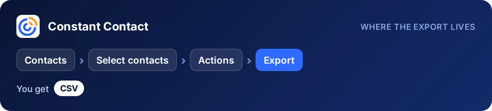</a>

Constant Contact exports the contacts you select, or a whole list, segment or tag. The file isn't downloaded straight away; it waits on the Import and Export Activity page, and only for 7 days. Put the download on the same to-do as the export, not next week's.

| Export details | What to know |
| :--- | :--- |
| **Where it lives** | Contacts → Select contacts → Actions → Export |
| **What you get** | Selected contacts, or a list, segment or tag, as a CSV. |
| **How it arrives** | A Download CSV link on the Import and Export Activity page. |
| **Expires** | 7 days after the export. |
| **Left behind** | Campaign reporting, which lives in each campaign's report. |
| **Who can do it** | Users with access to Contacts. |

> **Do this today:** Export all contacts and download the CSV the same day.

[Official export steps ↗](https://knowledgebase.constantcontact.com/articles/KnowledgeBase/5295-exporting-a-contact-list-from-constant-contact) · [↑ Browse the guide](#contents)

###  14 · Calendly

**[Export your meetings ↗](https://calendly.com/help/tracking-and-reporting)**

**Best for:** Consultants and service businesses booking through Calendly

<a href="https://calendly.com/help/tracking-and-reporting">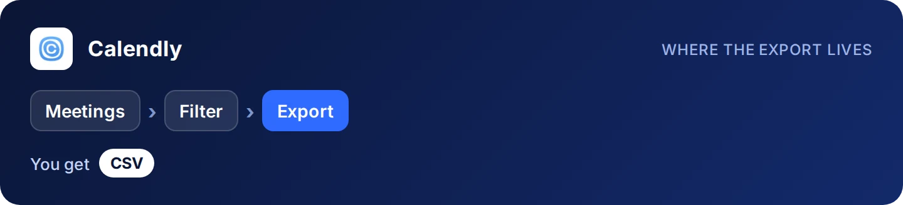</a>

Calendly's meeting export is the useful one: invitee names, contact details and time zones, event types, dates, locations, UTM parameters and payment details. The help page lists it on paid plans. Calendly also has a contacts export, but you select contacts before exporting and it isn't on every account yet, so the meeting export is the reliable way to get everyone who booked.

| Export details | What to know |
| :--- | :--- |
| **Where it lives** | Meetings → Filter → Export |
| **What you get** | Meetings with invitee details, event type, date, location, UTM and payment data. |
| **How it arrives** | Downloads straight away, or by email for large exports. |
| **Contacts** | Contacts → select → Export, where your account has it. |
| **Left behind** | Your event type setup and availability rules (screenshot them) |
| **Who can do it** | Users on the plans listed in Calendly's reporting article. |

> **Do this today:** Filter meetings to all time and export, then screenshot each event type's settings.

[Official export steps ↗](https://calendly.com/help/tracking-and-reporting) · [Import and export contacts ↗](https://calendly.com/help/how-to-import-and-export-contacts) · [↑ Browse the guide](#contents)

---

## 🌐 Websites and Online Stores

Orders, products and pages, and the builders that won't let your site leave.

###  15 · Shopify

**[Export customers, orders and products ↗](https://help.shopify.com/en/manual/fulfillment/managing-orders/exporting-orders)**

**Best for:** Online stores changing platforms or keeping records

<a href="https://help.shopify.com/en/manual/fulfillment/managing-orders/exporting-orders">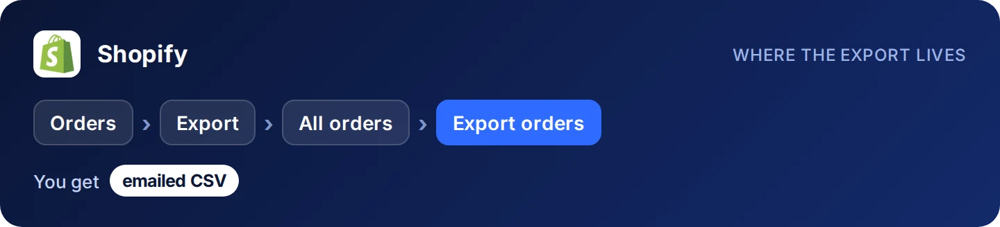</a>

Shopify exports customers, orders and products separately, each as a UTF-8 CSV. Anything over 50 rows is emailed to you and the store owner instead of downloading. In the orders export, an order with several items takes several rows with many fields left blank, which is normal. The transaction history export only includes captured payments.

| Export details | What to know |
| :--- | :--- |
| **Where it lives** | Orders → Export → All orders → Export orders |
| **What you get** | • Customers (with tags and supported metafields) • Orders, or transaction histories • Products |
| **How it arrives** | Up to 50 rows download. More are emailed to you and the store owner. |
| **Limits** | Customer exports are capped at 15 MB. Large order exports can take hours. |
| **Left behind** | • Your theme and pages • Authorizations in transaction history (captured payments only) |
| **Who can do it** | Staff with access to each section; the owner gets a copy of emailed exports. |

> **Do this today:** Export all orders, all customers with tags, and all products, and check the three emails arrive.

[Official export steps ↗](https://help.shopify.com/en/manual/fulfillment/managing-orders/exporting-orders) · [Export customers ↗](https://help.shopify.com/en/manual/customers/import-export-customers) · [↑ Browse the guide](#contents)

###  16 · Squarespace

**[Export your site content ↗](https://support.squarespace.com/hc/en-us/articles/206566687-Exporting-your-site)**

**Best for:** Squarespace sites moving to WordPress or anywhere else

<a href="https://support.squarespace.com/hc/en-us/articles/206566687-Exporting-your-site">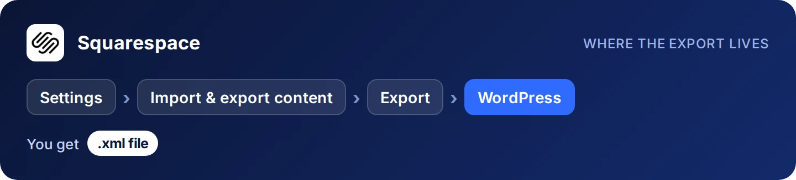</a>

Squarespace exports a WordPress-format XML file, and it's a partial export. You get layout pages, one blog with its posts and comments, and text and image blocks. You don't get store pages, product, audio or video blocks, drafts, styles or custom CSS. The big one: images in the export still point at Squarespace and stop working once you cancel, so download your images separately before you leave.

| Export details | What to know |
| :--- | :--- |
| **Where it lives** | Settings → Import & export content → Export → WordPress |
| **What you get** | Layout pages, one blog (up to 1,000 comments per post), text and image blocks, as WordPress XML. |
| **Left behind** | • Store, portfolio and index pages • Product, audio and video blocks • Extra blogs, drafts, styles, custom CSS, headers and footers |
| **Images** | Linked to Squarespace, not included. They break after you cancel. |
| **Before you start** | The site must be published and public. Trial sites can't export. |
| **Who can do it** | Someone with access to the site's settings. |

> **Do this today:** Pick your main blog, export, and download every image on the site before you cancel.

[Official export steps ↗](https://support.squarespace.com/hc/en-us/articles/206566687-Exporting-your-site) · [↑ Browse the guide](#contents)

###  17 · Wix

**[Save what Wix lets you take ↗](https://support.wix.com/en/article/wix-contacts-exporting-your-contacts)**

**Best for:** Wix site owners planning a rebuild elsewhere

<a href="https://support.wix.com/en/article/wix-contacts-exporting-your-contacts">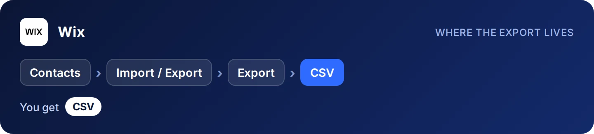</a>

This one's blunt: Wix says sites built in its editor can't be exported or hosted anywhere else. Leaving Wix means rebuilding the site. What you can take is your data: contacts (up to 50,000 per export, as a regular, Google or Outlook CSV), CMS collections including blog posts, store products, and your domain, which you can point at the new site.

| Export details | What to know |
| :--- | :--- |
| **Where it lives** | Contacts → Import / Export → Export → CSV |
| **What you get** | • Contacts (CSV, owner only) • CMS collections, such as blog posts (CSV) • Your domain |
| **Left behind** | • The design, pages and code • Labels in the Google CSV format |
| **Limits** | 50,000 contacts per export. Google CSV: 16 custom fields, 5 emails/phones/addresses per contact. |
| **Plan for** | A rebuild: copy page text and download images before you cancel. |
| **Who can do it** | The site owner. |

> **Do this today:** Export contacts and every CMS collection, then save each page's text and images into a folder.

[Official export steps ↗](https://support.wix.com/en/article/wix-contacts-exporting-your-contacts) · [Exporting or embedding your Wix site elsewhere ↗](https://support.wix.com/en/article/exporting-or-embedding-your-wix-site-elsewhere) · [↑ Browse the guide](#contents)

---

## 📁 Email and Files

Every email, calendar and document in your company account.

###  18 · Google Workspace and Takeout

**[Download your Google data ↗](https://support.google.com/accounts/answer/3024190)**

**Best for:** Owners leaving a staff account, or closing a company Google account

<a href="https://support.google.com/accounts/answer/3024190">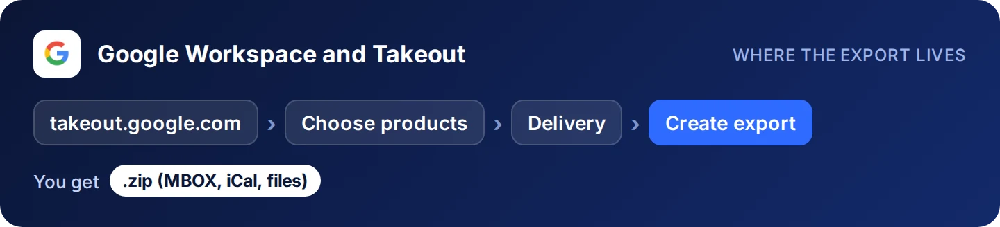</a>

Takeout downloads one person's Google data: Gmail as MBOX, Calendar as iCal, Contacts, Drive and more. The link usually arrives the same day and expires in about seven days, with five downloads per archive. On a company account, your admin decides whether Takeout is allowed. For the whole company, a super admin uses Workspace's Data Export tool instead, which also captures admin-only data and parks it in a Cloud Storage bucket for 60 days.

| Export details | What to know |
| :--- | :--- |
| **Where it lives** | takeout.google.com → Choose products → Delivery → Create export |
| **What you get** | Gmail (MBOX), Calendar (iCal), Contacts, Drive files and other Google products. |
| **How it arrives** | Email link, or straight to Drive, Dropbox, OneDrive or Box. Expires in about 7 days; 5 downloads. |
| **Left behind** | Drive files in shared drives or owned by someone else (they're in the owner's export). |
| **Whole company** | Admin console Data Export: Takeout's data plus admin-only data, deleted after 60 days. Over 1,000 users: contact support first. |
| **Who can do it** | Each user, if the admin allows Takeout. Super admins for Data Export. |

> **Do this today:** Before you delete a departing employee's account, run Takeout or a Data Export for that user.

[Official export steps ↗](https://support.google.com/accounts/answer/3024190) · [Export all your organization's data ↗](https://knowledge.workspace.google.com/admin/migrate/export-all-your-organizations-data) · [↑ Browse the guide](#contents)

---

## Three export plans

Most people aren’t leaving one tool. They’re switching a whole setup, or closing up. These are the orders we’d do it in.

### Switching field-service apps

  <picture>
    <source media="(max-width: 600px)" srcset="assets/plan-switch-mobile.svg">
    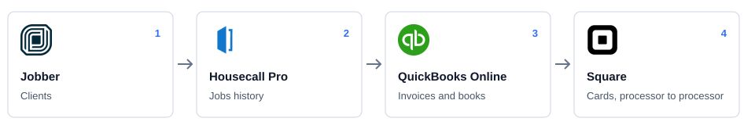
  </picture>

Customers first, because everything else hangs off them. Then job history with the full date range, then the books. Saved cards move last, from your old processor to the new one, never through your laptop.

**[Jobber](#jobber)** (Clients) → **[Housecall Pro](#housecall-pro)** (Jobs history) → **[QuickBooks Online](#quickbooks)** (Invoices and books) → **[Square](#square)** (Cards, processor to processor)

### Closing or selling the business

  <picture>
    <source media="(max-width: 600px)" srcset="assets/plan-close-mobile.svg">
    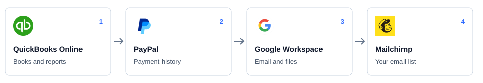
  </picture>

Your accountant and the tax office care about the books and payment history for years after you stop trading. Email and files cover the paper trail. A buyer will ask for the customer list.

**[QuickBooks Online](#quickbooks)** (Books and reports) → **[PayPal](#paypal)** (Payment history) → **[Google Workspace and Takeout](#google-workspace)** (Email and files) → **[Mailchimp](#mailchimp)** (Your email list)

### Leaving a website builder

  <picture>
    <source media="(max-width: 600px)" srcset="assets/plan-site-mobile.svg">
    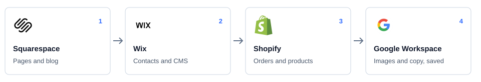
  </picture>

Website builders hand over the least. Export what they allow, then save every image and page's text yourself before the old site goes dark, and move the domain last.

**[Squarespace](#squarespace)** (Pages and blog) → **[Wix](#wix)** (Contacts and CMS) → **[Shopify](#shopify)** (Orders and products) → **[Google Workspace and Takeout](#google-workspace)** (Images and copy, saved)

> Swap in the tools you actually use. The order matters more than the logos.

---

## When an export isn’t enough

An export gets your data out. It doesn’t get it *in* anywhere. That part is where most switches go sideways.

**Columns don’t match.** Your old CRM calls it “Company,” the new one wants “Account Name,” and the custom field your crew used for gate codes has nowhere to go. Every import needs a mapping, and someone has to decide what happens to the fields that don’t fit.

**IDs break.** Exports usually keep relationships as IDs: this deal belongs to contact 48213. Import the contacts and they get new IDs, and every deal now points at nobody. HubSpot lets you export associations; Pipedrive exports activities and notes separately. Plan how they’ll be stitched back together before you import anything.

**History doesn’t fit.** Ten years of invoices, closed jobs and email opens rarely belong in the new system. Most businesses bring over open work and recent history, and keep the rest as a read-only archive (the exports in this guide, saved somewhere you’ll find them).

**Cards are their own project.** Square and Stripe will move saved cards to your new processor, but only to a PCI DSS Level 1 processor, only on the owner’s request, and Square quotes up to two weeks. Start that early, or plan for customers to re-enter cards.

If you’re partway through a switch, these guides go deeper: [what to check before you switch CRMs](https://www.futurebuiltdigital.com/resources/crm-switch-checklist), [moving off spreadsheets one piece at a time](https://www.futurebuiltdigital.com/resources/outgrown-spreadsheets), and [who should own your website’s accounts](https://www.futurebuiltdigital.com/resources/website-ownership-checklist).

When the mapping, the IDs and the cutover are the hard part, that’s the work we do. See [data and analytics](https://www.futurebuiltdigital.com/capabilities/data-analytics) or tell us what you’re moving.

---

## Export one thing this week

You don’t have to back up everything today. Pick the tool that would hurt most to lose (for most businesses it’s the customer list or the books), run its export, open the file, and save it somewhere that isn’t that tool.

Then put a reminder on the calendar to do it again in three months. The [export checklist](downloads/export-checklist.csv) has a row for every tool in this guide, with columns for when you exported, where you saved it, and whether you opened it.

Moving to new software and want a hand? Email [dakota@futurebuiltdigital.com](mailto:dakota@futurebuiltdigital.com) or fill out the [quote form](https://www.futurebuiltdigital.com/start-a-project). Happy to do the move or just point you in the right direction.

We update this guide when export steps change. [Subscribe](https://www.futurebuiltdigital.com/sign-in?next=/resources) to get the next version, plus whatever else we’re building... no spam, just useful stuff.

**[Explore more resources ↗](https://www.futurebuiltdigital.com/resources) · [25 free tools for small business ↗](https://github.com/kodyk448/free-tools-for-small-business) · [Talk to Dakota ↗](https://www.futurebuiltdigital.com/start-a-project)**

---

### Keep this guide useful

Menus move. [Open an issue](https://github.com/kodyk448/small-business-data-export-guide/issues/new) or send a pull request with the tool, what changed, and a link to the vendor’s help page. You can also email [dakota@futurebuiltdigital.com](mailto:dakota@futurebuiltdigital.com).

If this guide helped, **star the repository** so you can find it again when you need it, and so other small business owners can find it too.

*Steps checked against vendor help pages on November 18, 2026. Product names and logos belong to their respective owners. [Image sources](assets/README.md).*

---

  

<a href="https://ko-fi.com/dakotakronberger"><strong>Support Dakota on Ko-fi ☕</strong></a>

<a href="#top">↑ Back to the top</a>

